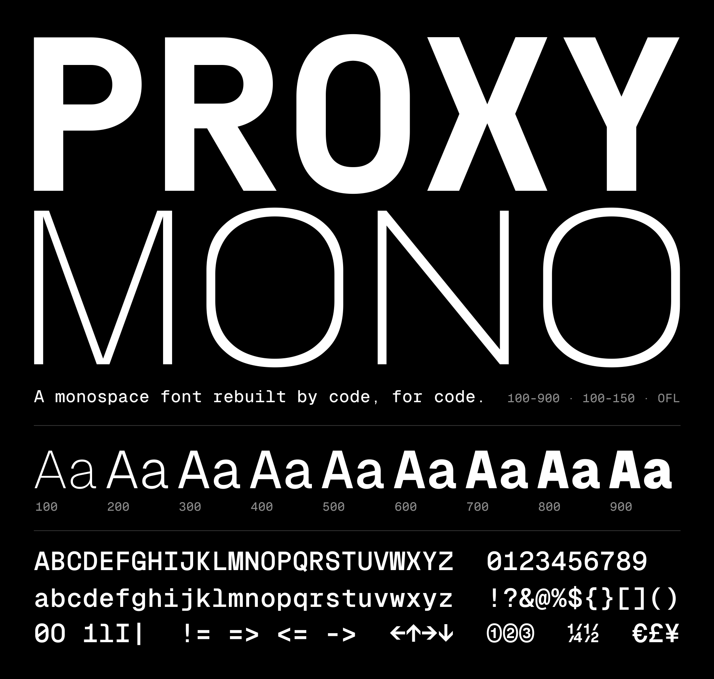
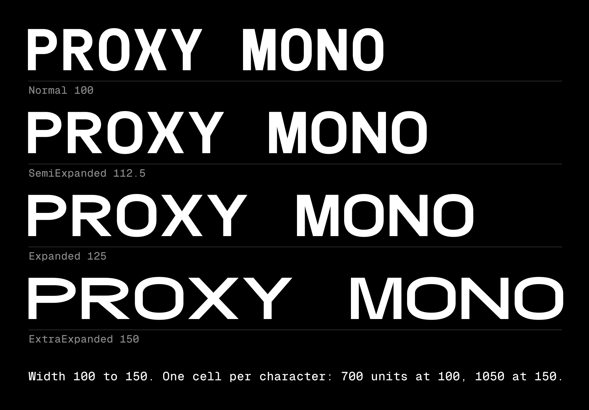
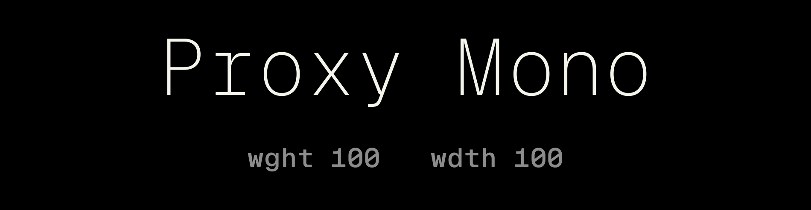
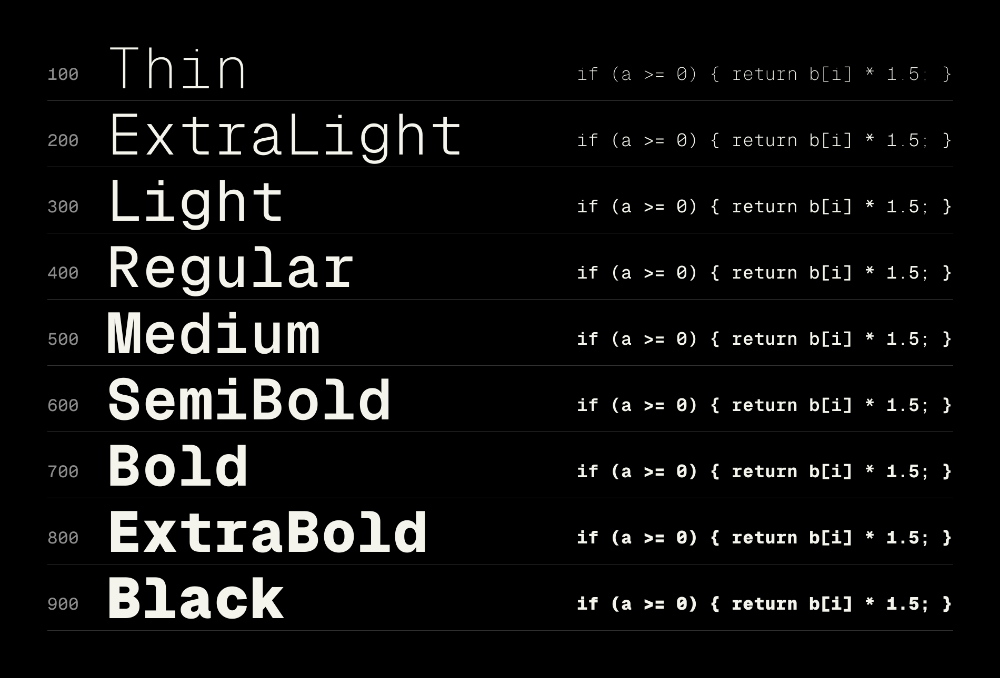
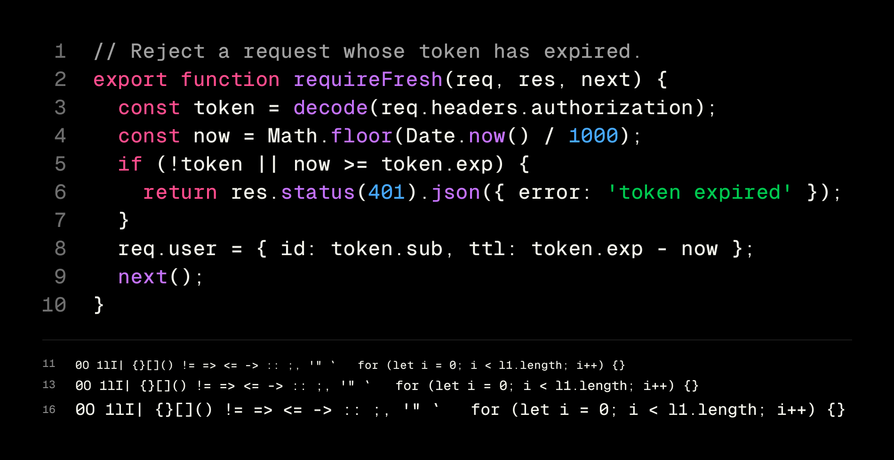
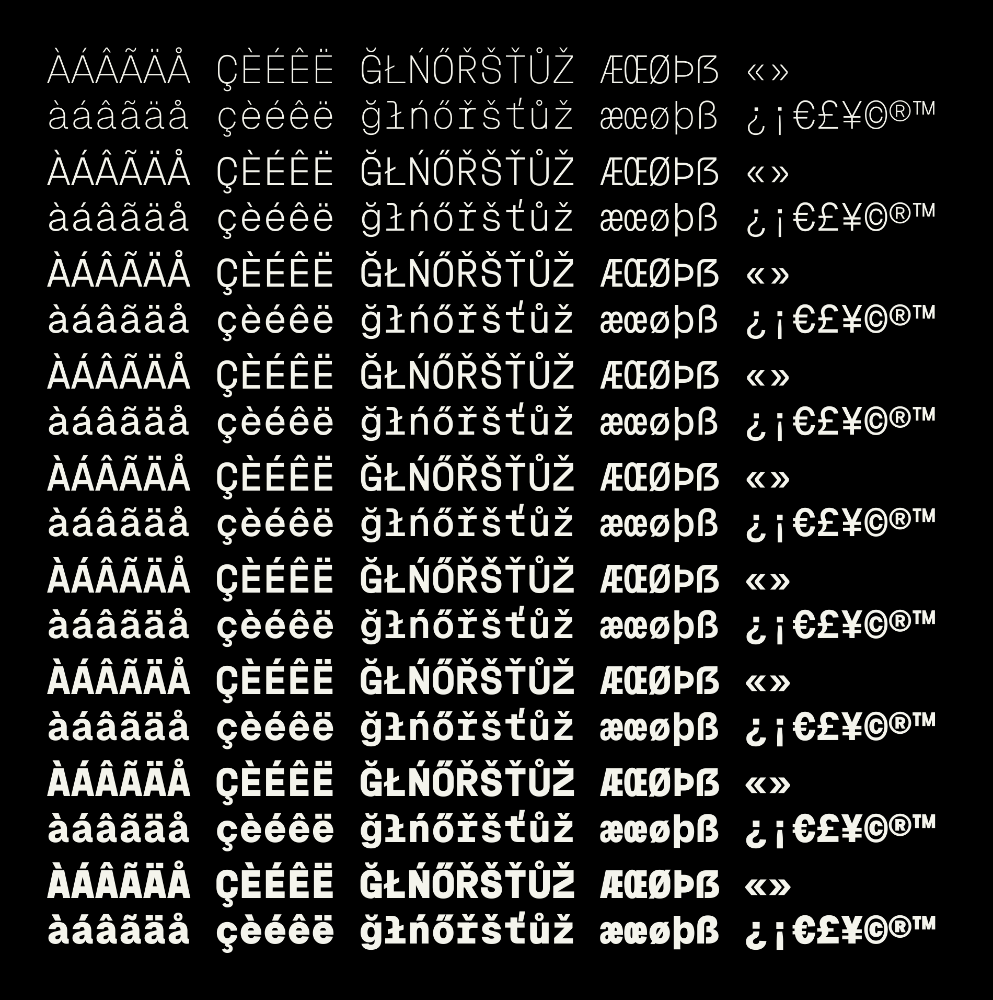

# Proxy Mono

A monospaced typeface, built by code, for code.\
One variable family. Weight Thin (100) to Black (900). Width Normal (100) to ExtraExpanded (150).

Not drawn. Specified.

1. **One cell.** Every character is 700 units wide. At ExtraExpanded, the cell grows to 1050.
2. **One stem.** Every upright stroke has the same thickness.
3. **One baseline, one set of margins.** Every glyph sits in its cell the same way.
4. **No inherited detail.** Features from the source designs that break the system are removed.
5. **Rebuilt, not reused.** Where a glyph does not follow the rules, it is redrawn from them.
6. **Related forms stay related.** Letters that share parts share them exactly.
7. **Every rule is measured.** Stroke thickness, joins and stems are checked in numbers before the eye.
8. **One program, every variation.** Weight, width and slant are parameters, varied continuously; the rules hold at every point between them.

It works as a display heading and holds up at the smallest size in an editor.

Nothing added. Nothing left that does not serve the line.

Rules after Karl Gerstner's *Designing Programmes* and Norm.

**Specimen and type tester:** https://www.monoproxy.studio/lab/proxymono











## Coverage

611 encoded characters: GF Latin Core and more. Western, Central and Eastern European languages,
Vietnamese, and a wide set of symbols, arrows, currencies and fractions.



## Design & Lineage

Proxy Mono is built from three open-source monospaced typefaces. Capitals inherit from Space Mono and
Martian Mono; the lowercase uses Geist Mono as its baseline reference. Each glyph is rebuilt to one cell
and one stem, and those that would not follow the rules are rebuilt: M, N and W, and G, Q and the zero,
built from Proxy Mono's own C and O.

## Download

The latest fonts are in [`fonts/`](fonts): `variable/` for the variable font (width and weight), `ttf/`
for the nine static weights at Normal width, `webfonts/` for the web.

`slant/` holds the weight family with a slant axis, 0 to 10° (an oblique, not a drawn italic), at Normal
width. It is not part of the Google Fonts submission, which is width and weight.

## Building

The fonts are generated by Python scripts in `sources/generator/`, not drawn in a font editor.
`sources/masters/` holds the nine masters as UFOs with a designspace, written on every build, so the
outlines can be opened in a font editor.

```
make build   # fonts/variable, fonts/ttf and fonts/webfonts (about 4 minutes)
make test    # fontspector, Google Fonts profile
```

## Quality assurance

fontspector, Google Fonts profile: 3 failures, 8 warnings. The failures are one check: Google's sample
texts for Amarakaeri, Otomi Mezquital and Secoya use the combining macron below (U+0331), which belongs
to no Google Fonts subset, so the font leaves it out.

## Upstream

Proxy Mono incorporates and modifies material from these SIL Open Font License fonts. Their notices are kept in
[OFL.txt](OFL.txt) and [AUTHORS.txt](AUTHORS.txt):

- Space Mono: Copyright 2016 The Space Mono Project Authors
- Martian Mono: Copyright 2021 The Martian Mono Project Authors
- Geist Mono: Copyright 2024 The Geist Project Authors

## License

This Font Software is licensed under the SIL Open Font License, Version 1.1. See [OFL.txt](OFL.txt),
also available with a FAQ at https://openfontlicense.org
